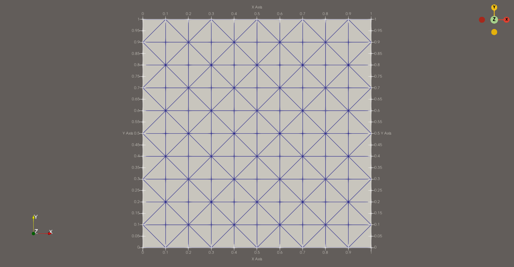
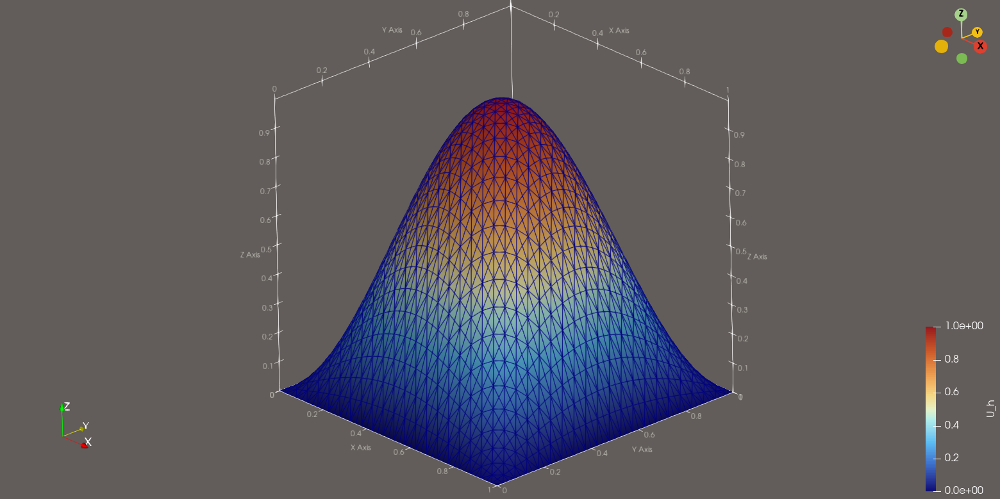
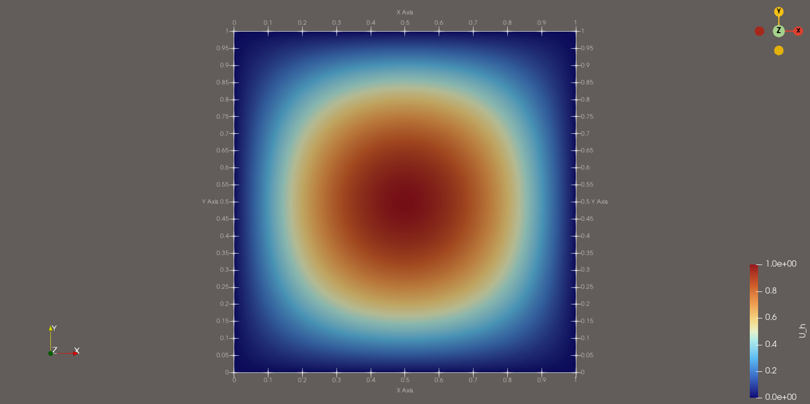
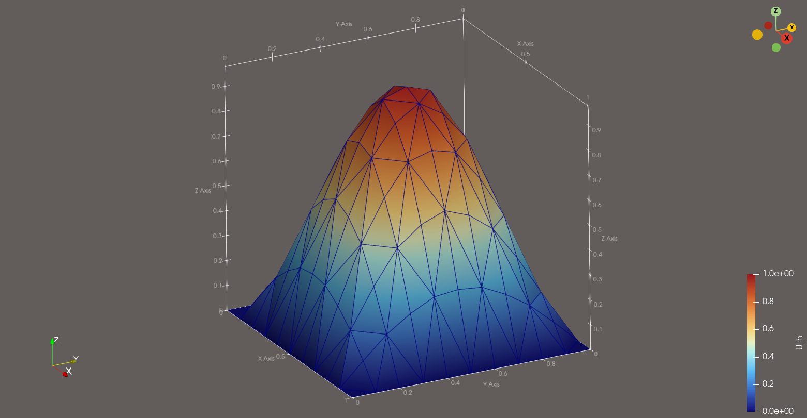
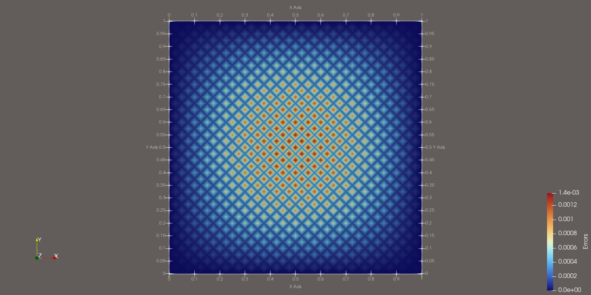
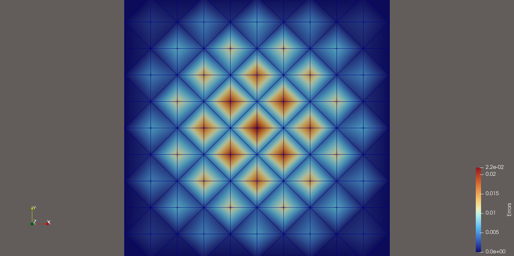
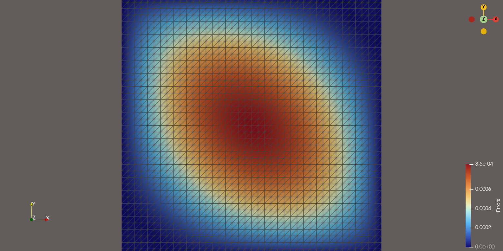

# Solveur 2D par éléments finis en C++

## Présentation

Ce projet a été développé dans le cadre de mon apprentissage du C++, de git et des méthodes numériques, ici la méthode des éléments finis. J'ai developpé la génération de maillage triangulaire, l'assemblage du système linéaire issu de la discrétisation par éléments finis, le stockage de matrices creuses et la résolution par gradient conjugué. Le projet comprend également une étude de convergence et l'export des résultats pour leur visualisation dans ParaView. Le projet est développé en C++17 et utilise OpenMP pour paralléliser certaines opérations.

## Problème mathématique

On cherche à résoudre l'équation de Poisson sur le carré unité :

$$
\Omega = [0,1]^2.
$$

Le problème considéré est :
$$
\begin{cases}
-\Delta u = f & \text{dans } \Omega,\\
u = 0 & \text{sur } \partial\Omega.
\end{cases}
$$
Le second membre est défini par :
$$
f(x,y) = 2\pi^2\sin(\pi x)\sin(\pi y).
$$
La solution exacte est connue :
$$
u(x,y) = \sin(\pi x)\sin(\pi y).
$$
Cette solution analytique permet d'évaluer la précision de la solution numérique obtenue.

## Méthodes numériques

Le domaine est d'abord découpé en un maillage composé d'éléments triangulaires alternés. La méthode des éléments finis P1 est ensuite utilisée pour approcher la solution : sur chaque triangle, la solution numérique est représentée par une fonction affine, définie à partir des valeurs de la solution aux sommets du triangle.

Les principales étapes du calcul sont les suivantes :

1. Génération du maillage triangulaire du domaine.
2. Assemblage de la matrice de rigidité et du second membre.
3. Application des conditions aux limites de Dirichlet homogènes.
4. Stockage de la matrice creuse au format CSR (*Compressed Sparse Row*).
5. Résolution du système linéaire par la méthode du gradient conjugué.
6. Calcul de l'erreur numérique par comparaison avec la solution exacte.

## Organisation du projet

| Fichiers | Description |
|---|---|
| `main.cpp` | Point d'entrée du programme. |
| `simulation.cpp` / `simulation.hpp` | Responsable des principales étapes du calcul. |
| `fem.cpp` / `fem.hpp` | Calculs liés à la méthode des éléments finis. |
| `mesh_data.cpp` / `mesh_data.hpp` | Structures et génération du maillage. |
| `csr_matrix.cpp` / `csr_matrix.hpp` | Représentation des matrices creuses au format CSR. |
| `linalgebra.cpp` / `linalgebra.hpp` | Opérations d'algèbre linéaire. |
| `solver.cpp` / `solver.hpp` | Résolution du système linéaire via gradient conjugué ou pivot de Gauss. |
| `error.cpp` / `error.hpp` | Calcul des erreurs numériques. |
| `vtk_writer.cpp` / `vtk_writer.hpp` | Export des résultats au format VTK. |
| `utils.cpp` / `utils.hpp` | Fonctions utilitaires. |
| `Screens/` | Captures des visualisations. |
| `Solutions/` | Dossier des résultats au format VTK pour ParaView. |

## Résultats numériques

### Étude de convergence en norme L²

L'erreur entre la solution exacte $u$ et la solution approchée $u_h$ est étudiée pour plusieurs résolutions du maillage. Pour une solution suffisamment régulière, les éléments finis P1 présentent un ordre de convergence théorique de 2 en norme L² :

$$
\|u-u_h\|_{L^2(\Omega)} = O(h^2),
$$

où $h$ désigne la taille caractéristique du maillage.

L'étude numérique permet de comparer l'ordre de convergence observé à cette prédiction théorique. 

| N | Erreur L2 | Temps (s) | Rapport d'erreurs | Ordre expérimental |
|:-:|:---------:|:---------:|:-----------------:|:------------------:|
10 | 1.719117e-02 | 0.004371 | 3.974324 | 1.990709
20 | 4.325558e-03 | 0.022889 | 3.993611 | 1.997694
40 | 1.083119e-03 | 0.031041 | 3.998405 | 1.999425
80 | 2.708879e-04 | 0.098123 | 3.999601 | 1.999856
160 | 6.772872e-05 | 0.297993 | 3.999900 | 1.999964
320 | 1.693260e-05 | 1.245667 | 3.999975 | 1.999991
640 | 4.233177e-06 | 7.174297 | 3.999991 | 1.999997
1280 | 1.058297e-06 | 24.120502 | / | / |

Pour ce tableau, 4 threads ont été utilisés. On observe bien que l'erreur en norme L² diminue lorsque la résolution du maillage augmente. Le rapport entre deux erreurs successives est d'environ 4 comme c'est attendu théoriquement.

## Visualisation

Les résultats numériques sont exportés au format VTK et peuvent être visualisés avec [ParaView](https://www.paraview.org/).

Les fichiers exportés peuvent notamment contenir les champs suivants :

- `U_h` : solution numérique ;
- `U_exa` : solution exacte ;
- `Errors` : erreur absolue en chaque nœud.

### Maillage


*Maillage avec une discrétisation à N = 10, les triangles sont alternés ici.*
### Solution numérique


*Solution vue de côté pour N = 40.*

*Solution vue de dessus pour N = 40.*

*Solution pour N = 10.*

### Distribution de l'erreur

Pour l'erreur, on compare les valeurs de la solution numérique et celles de la solution exacte aux nœuds du maillage : $$|u(x,y)-u_h(x,y)|.$$


*Erreur sur les noeuds du maillage pour N = 40.*

*Erreur sur les noeuds pour N = 10.*

*Erreur sur les noeuds avec un maillage triangulaire non alterné pour N = 40.*

On observe une répartition de l'erreur différente en fonction de si le maillage est constitué de triangles qui sont alternés ou non. Dans le cas des triangles alternés, on observe que l'algorithme du gradient conjugué converge en deux itérations tandis qu'il en faut au moins cinquante dans le cas où les triangles ne sont pas alternés. Une analyse complémentaire serait nécessaire pour expliquer les raisons de ces différences. En revanche, la norme L² est semblable.

## Compilation et exécution

### Prérequis

- Un compilateur C++ compatible avec C++17, comme GCC.
- Une installation de GCC prenant en charge OpenMP.
- ParaView pour visualiser les résultats.

### Compilation

Depuis le répertoire racine du projet, compiler les fichiers sources avec :

```bash
g++ -std=c++17 -fopenmp *.cpp -o main
```

### Exécution

Lancer le programme avec :

```bash
./main
```

### Choix du nombre de threads

Le nombre de threads OpenMP peut être défini à l'aide de la variable d'environnement `OMP_NUM_THREADS`. Par exemple, pour utiliser 4 threads :

```bash
OMP_NUM_THREADS=4 ./main
```

